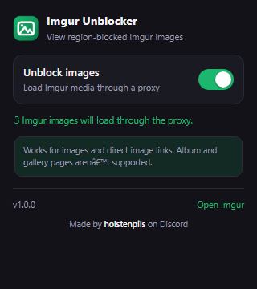

# Imgur Unblocker

A Chrome extension (Manifest V3) that loads Imgur images through DuckDuckGo's image proxy when Imgur shows:

> Content not viewable in your region.

It is for people in regions where Imgur blocks its media. The extension does **not** hide the blocked posts — it makes the actual image load.

  

## Install

1. Open `chrome://extensions` in Chrome (or Edge/Brave).
2. Turn on **Developer mode** (top-right toggle).
3. Click **Load unpacked**.
4. Select this folder (`imgur-unblocker`).
5. Refresh any page with Imgur images.

## Use

- Click the toolbar icon to pause/resume the proxy.
- The badge shows how many Imgur images were detected on the current page.
- The popup also shows the count and the current state.

## How it works

- A `declarativeNetRequest` rule redirects `i.imgur.com` image requests to:
  `https://external-content.duckduckgo.com/iu/?u=<original-url>`
- A second rule handles direct `imgur.com/...jpg|png|gif|webp|avif` links.
- A content script counts Imgur images and rewrites single-post links such as
  `https://imgur.com/Rt637e5` to the proxied `.png` version.
- Toggling the popup enables/disables the ruleset and restores rewritten links.

No analytics, no remote code, and no data collected by the extension.

## Limitations

- **Albums and gallery pages are not supported.** DuckDuckGo's image proxy only
  returns a single image; it cannot render an Imgur gallery page. Use a VPN if you
  need full Imgur site access.
- **Video and GIFV files are not proxied.** The proxy only serves images, so
  `i.imgur.com/*.mp4` playback will not work. Animated GIFs (`.gif`) do work.
- The proxy is a third-party service. The URLs of Imgur images you view are sent
  to DuckDuckGo's image proxy. Don't use it for private images.
- Imgur may change its URL formats or block the proxy at any time. If that
  happens, the extension may stop working.
- This may conflict with Imgur's terms or local rules. Use it at your own
  discretion.

## Credit

Built by **holstenpils** on Discord. All rights reserved — see `LICENSE`.

The credit is shown in the extension popup and in the header of each source file.
Please leave it in place if you fork this code.

## Files

| File | Purpose |
| --- | --- |
| `manifest.json` | Extension manifest (MV3) |
| `rules.json` | Proxy redirect rules |
| `background.js` | Ruleset sync and badge count |
| `content.js` | Image count and post-link rewriting |
| `popup.html` / `popup.css` / `popup.js` | Toolbar toggle and status |
| `icons/` | Extension icons |
| `LICENSE` | Copyright and usage terms |
